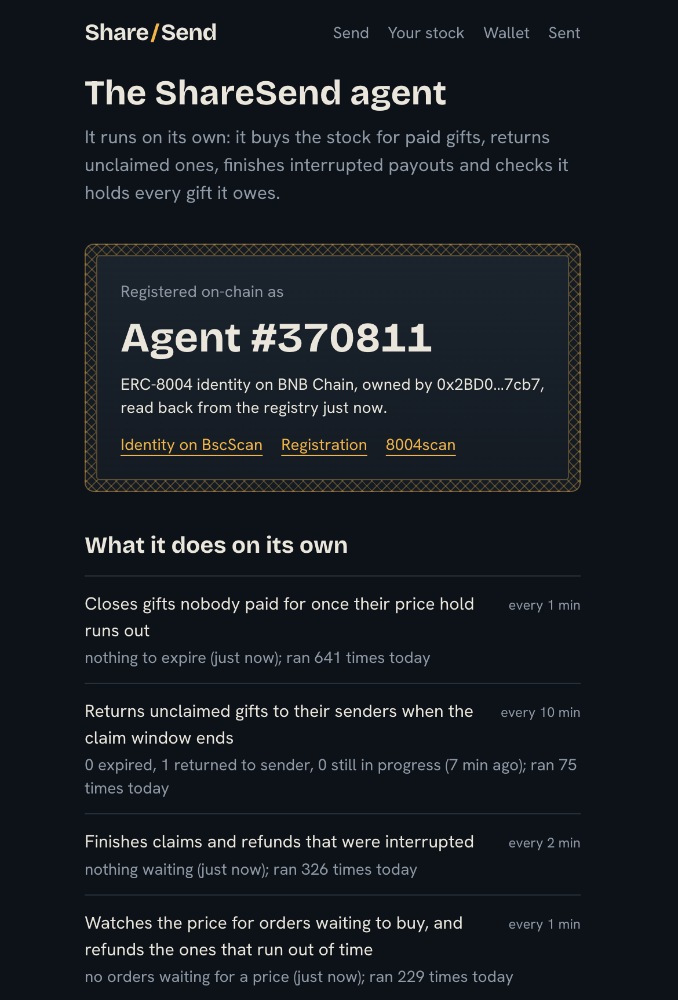
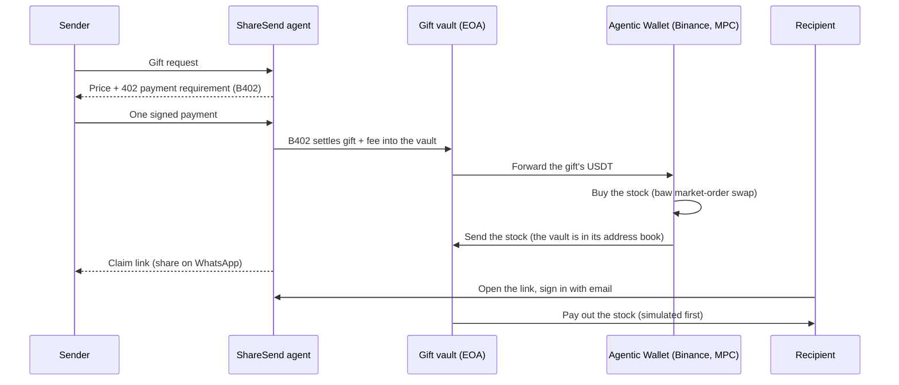

# ShareSend

**Send stocks, not cash.** Pick a stock and an amount. Your friend gets a link on WhatsApp and claims a real slice of it with just their email. An autonomous agent buys the stock, holds it safely, and sends back whatever isn't claimed.

Built for **BNB Hack: Tokenized Stocks Edition**, on BNB Chain mainnet.

| | |
|---|---|
| App | https://sharesend-production.up.railway.app |
| The agent (identity, jobs, proof of holdings) | https://sharesend-production.up.railway.app/agent |
| On-chain identity | ERC-8004 agent [#370811](https://bscscan.com/nft/0x8004A169FB4a3325136EB29fA0ceB6D2e539a432/370811) |
| Every live transaction | [`docs/demo-proof.md`](docs/demo-proof.md) |
| Demo video | _add link before submitting_ |



## The problem

Sending money home is easy. Giving someone their first share of Nvidia is nearly impossible for most people in Nigeria and other emerging markets. Tokenized stocks on BNB Chain make it technically possible, but the experience is built for crypto users, not for a mum or a little sister.

## What it does

1. **Send.** The sender picks a stock and an amount ("$5 of Nvidia for Ada, happy birthday"). ShareSend compares the issuers, shows a price, takes payment with **one signature**, buys the stock, and returns a claim link to share on WhatsApp. They can also describe the gift in plain English ("only if it drops 0.5% by tomorrow 2PM"); an assistant fills in the form, and the sender still checks and pays.
2. **Claim.** The recipient opens the link on their phone, sees what they received (company profile, value when sent and now), signs in with their **email**, and the shares land in a wallet made for them. No seed phrase, no gas, no exchange.
3. **Return.** Unclaimed gifts go back to the sender after 30 days, or sooner if they cancel, either as the stock or **sold into USDT**, the sender's choice. A gift that can't be bought is refunded in full.

## How it works

Two wallets, because the Agentic Wallet can only send to addresses saved in its address book, and a gift for a stranger can't be in anybody's address book.



| Wallet | Controlled by | Job |
|---|---|---|
| **Agentic Wallet** | `baw` CLI, keyless MPC | Buys stock and sends it to the vault. Sells it back when a sender asks for USDT. |
| **Gift vault** | The agent service (server-side key) | Receives payments, holds unclaimed gifts, pays out claims, returns and refunds to any address. Needs no Binance session, so **claims, returns and refunds keep working while the Agentic Wallet is signed out**. |

Gift lifecycle: `AWAITING_PAYMENT → PAID → BUYING → READY → CLAIMING → CLAIMED`, with `EXPIRED`, `REFUNDING → REFUNDED`, `FAILED` and `RETURNING → RETURNED` as the off-ramps. Every transition is a compare-and-set in Postgres, and every execution step is recorded before it happens, so a crash or retry resumes where it stopped and never repeats a purchase or payout.

## Binance modules used, and why

| Module | Use in ShareSend |
|---|---|
| **RWA Data API** | Stock list and search, company profile, market status and reference price, issuer websites. Sets what can be offered and what a gift is worth. |
| **Market API** | Candles for the value charts on the claim and "Your stock" pages (bad prints are filtered out against the reference price). |
| **Trading API** | Aggregated quotes behind every price shown, and the cross-check that must agree with the Agentic Wallet's own quote before a buy or a sell. |
| **Transaction API** | Every transfer out of the vault is simulated before it's signed. Broadcast is wired into the vault's send path. |
| **Wallet API** | Balances for the holdings page. |
| **B402 Payments** | The sender pays gift + fee with one signature (EIP-3009 or Permit2); the fee funds the agent. `verify` then `settle`, idempotent. |
| **Agentic Wallet** | Executes every buy, every move of stock into the vault and every sell-back. A keepalive job keeps its session alive. |
| **BNB Agent Studio (ERC-8004)** | The agent's on-chain identity, registered with `@bnbagent/sdk`. |
| **BNB Chain** | Settlement for payments, buys, claims, returns and refunds. |

Not used: the DeFi API, and Agent Studio's managed runtime (it has no scheduling, so the jobs run on our own service; see [`docs/operations.md`](docs/operations.md)).

## Security design

- **The AI proposes, code disposes.** The chat assistant has one tool that only returns a draft. Code validates every field (the stock must exist, amount limits, a deadline with a time zone), and the sender reviews the form and pays. It can't buy, send or sign.
- **One address to send to.** The agent only ever sends from the Agentic Wallet to the vault, and never adds addresses to its address book. The wallet's address book is configured by hand in the Binance app, outside the code.
- **Vault key hygiene.** The key lives only in the agent service's environment, is never logged, and the vault holds only unclaimed gifts plus a small BNB float.
- **Claim codes** are 128-bit random, stored only as a SHA-256 hash, and live in the link's `#` fragment, so they're never sent in the page request or written to logs.
- **One claim only.** `READY → CLAIMING` is atomic; two simultaneous claims produce exactly one winner. Failed attempts are rate-limited per IP and per gift.
- **Simulate before sending.** Every vault transfer is simulated against the Transaction API; every buy and sell cross-checks the `baw` quote against the Trading API.
- **No double charges or sends.** B402 settlement is idempotent on the signed payload, and each step has a record that makes a retry a no-op.
- **Caps in code:** $20 a gift and $50 a day, enforced by the server, on top of the Agentic Wallet's own limits.
- **Proof of holdings.** Every 15 minutes the agent checks the vault holds the stock owed on every unclaimed gift, and reports it on [`/agent`](https://sharesend-production.up.railway.app/agent). A drop below liabilities raises an alert.
- **Honest custody disclosure.** The MVP holds unclaimed gifts in the vault. The stock tokens' issuers (bStocks, Ondo) keep their own powers: they can pause or restrict a token, and Ondo can burn. See [`docs/issuers.md`](docs/issuers.md).

### Session resilience

Agentic Wallet sessions last 48 hours and re-signing needs a phone. A keepalive job watches the session, alerts before it ends, and the `/admin` page signs it back in. While it's signed out, new gifts wait as "queued" and are bought after sign-in; claims, returns, refunds and reconciliation are unaffected. See [`docs/operations.md`](docs/operations.md).

## Autonomous agent

Registered on-chain as ERC-8004 agent #370811. Seven jobs run by themselves on the agent service and report to `/agent`: close unpaid gifts, return unclaimed ones, finish interrupted payouts, watch prices for waiting orders (and refund the ones that run out of time), buy for paid gifts, check the vault's holdings, and keep the trading wallet's session alive. Fees from gifts are recorded in a self-funding ledger next to what the agent spends.

## What's proven on mainnet

With real $1 gifts of NVDAB, every transaction linked in [`docs/demo-proof.md`](docs/demo-proof.md):

- Payment (B402) → purchase → vault → **claim**.
- A gift cancelled with **return as USDT**: bought, sold back and USDT returned to the sender.
- A **failed purchase refunded** in full.

Covered by automated tests but not exercised with real funds: conditional price orders, the wallet send page, and claiming while the trading wallet is signed out.

## Network and hosting

| | |
|---|---|
| Chain | BNB Smart Chain mainnet (`eip155:56`) |
| Agent service | Railway, Singapore (`asia-southeast1`). Binance's APIs refuse some regions, so the service runs where they don't |
| Web app | Railway (Next.js) |
| Database | PostgreSQL (Railway) |
| Stock tokens | bStocks and Ondo (the issuers the Binance RWA API lists on BSC); the picker chooses the cheaper per share |
| Payment assets | USDT, USDC, United Stables (U), USD1, as B402 supports them |

| Address | |
|---|---|
| Gift vault | [`0xF72ae96cB04c5A8036617474d13eED8610ff260C`](https://bscscan.com/address/0xF72ae96cB04c5A8036617474d13eED8610ff260C) |
| Agentic Wallet | [`0x3Dd47653417043C09C303d507B243c527529D892`](https://bscscan.com/address/0x3Dd47653417043C09C303d507B243c527529D892) |
| Identity registry (ERC-8004) | [`0x8004A169FB4a3325136EB29fA0ceB6D2e539a432`](https://bscscan.com/address/0x8004A169FB4a3325136EB29fA0ceB6D2e539a432) |

## For judges

1. **See the agent working:** open [`/agent`](https://sharesend-production.up.railway.app/agent). The identity is read back from the chain, and each job shows its last run.
2. **Claim a gift:** use one of the claim links in the submission form. Open it on a phone, sign in with an email, tick the eligibility box and claim. Tokenized US stocks aren't offered in the United States and some other countries; you confirm you're allowed to hold them.
3. **Check the money:** every payment, purchase, claim, return and refund is on BscScan in [`docs/demo-proof.md`](docs/demo-proof.md).
4. **Send one yourself** at [`/send`](https://sharesend-production.up.railway.app/send): needs a wallet with a few dollars of USDT, USDC, U or USD1 on BNB Chain.

## Run it yourself

Requires Node 22 and PostgreSQL.

```bash
npm install
cp .env.example .env          # fill in the values; .env is never committed
npm run migrate               # create the tables
npm run dev                   # agent service on :8080
cd web && npm install && npm run dev   # web app on :3000
npm test                      # agent tests (set TEST_DATABASE_URL for the database ones)
cd web && npm test            # wallet-send checks
npm run cli -- quote NVDA 5   # live quotes from both issuers
npm run cli -- dryrun NVDA 5  # full gift lifecycle with LIVE_TRADING=false
```

You need a Binance Web3 API key (with B402 permission), a Privy app, and the `baw` CLI signed in for buys. `LIVE_TRADING=false` (the default) quotes and simulates only. Details, the sign-in procedure and every operator command are in [`docs/operations.md`](docs/operations.md); the friction log behind our developer-experience report is [`docs/dx-log.md`](docs/dx-log.md).

```
agent/        Agent service (Hono): Binance clients, pricing, gift ledger, execution, payments, jobs, chat
web/          Next.js app: landing, send, claim, wallet, agent page
docs/         issuers, operations, live proof, friction log
```

## Roadmap

- A non-custodial escrow contract with signature-based claims, instead of the custodial vault.
- Contacts, and sending the claim link automatically over SMS or WhatsApp.
- Remittance split: part cash, part into an index fund.
- Scheduled sends, and cash-out to USDT for recipients.
- A Telegram interface.
