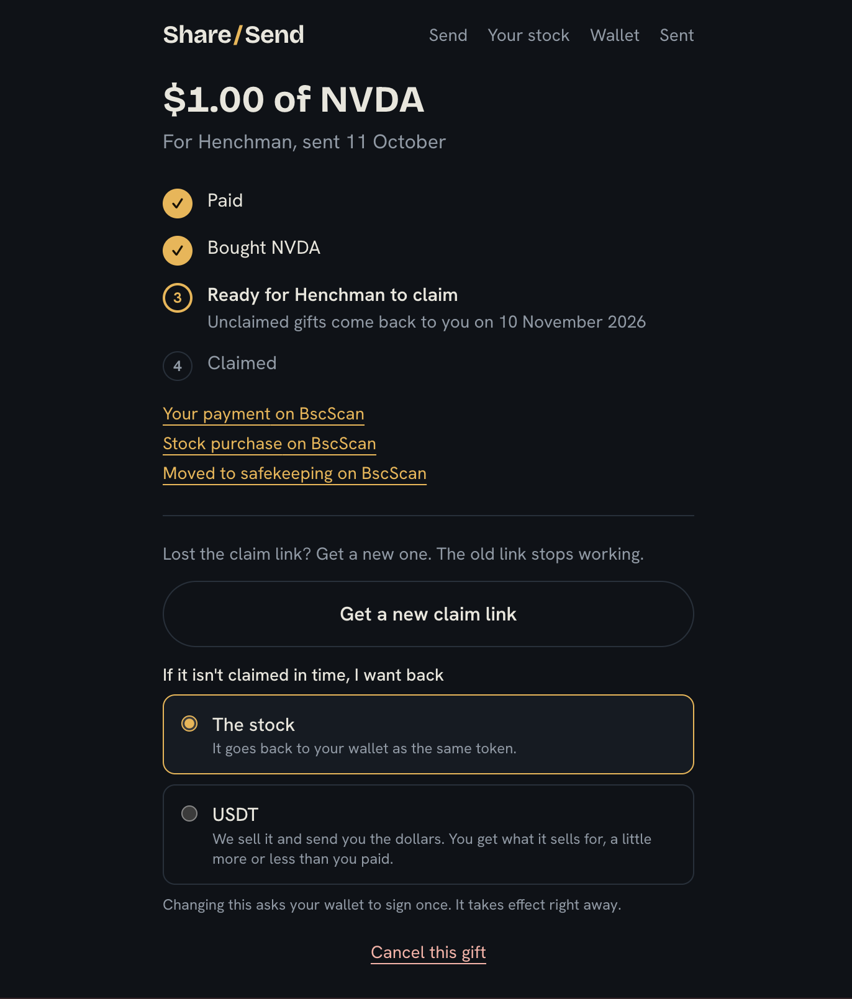
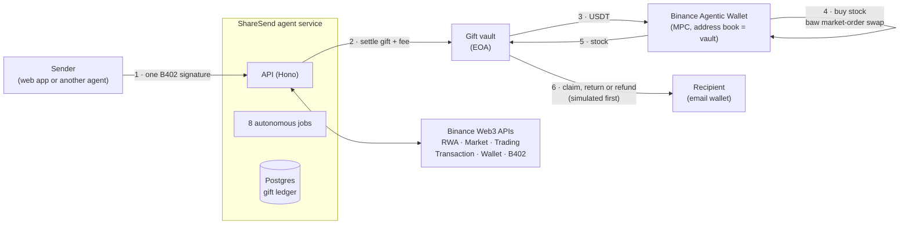
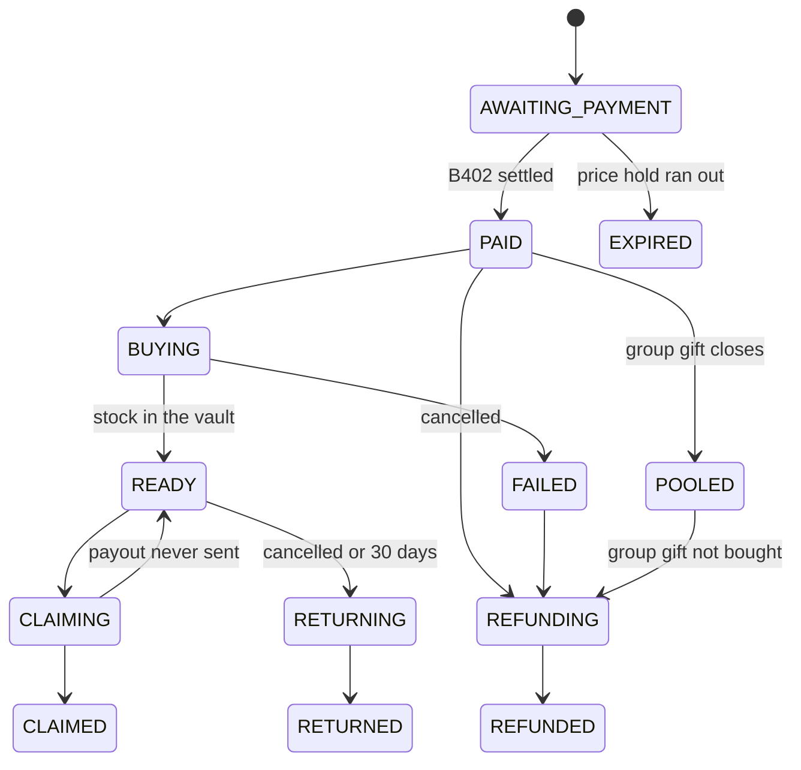
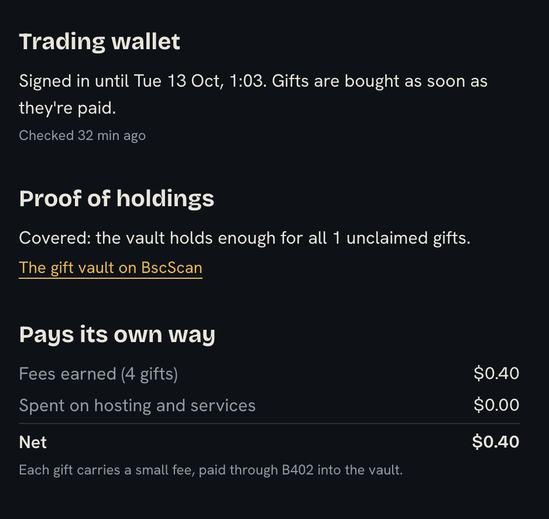

<div align="center">

# ShareSend

### Send stocks, not cash.

Gift anyone a slice of a real US company over WhatsApp. They claim it with just their email.<br/>
An autonomous agent, registered on BNB Chain, buys the stock, keeps it safe and sends back whatever isn't claimed.

[](https://bscscan.com/address/0xF72ae96cB04c5A8036617474d13eED8610ff260C)
[](https://bscscan.com/nft/0x8004A169FB4a3325136EB29fA0ceB6D2e539a432/370811)
[](#built-on-binance-web3-and-bnb-chain)
[](docs/issuers.md)

**[Live app](https://sharesend-production.up.railway.app)** ·
**[Watch the agent](https://sharesend-production.up.railway.app/agent)** ·
**[Mainnet proof](docs/demo-proof.md)** ·
**[For agents](https://sharesend-production.up.railway.app/agents)** ·
**Demo video:** _add link before submitting_

Built for **BNB Hack: Tokenized Stocks Edition**.

</div>



---

## Contents

- [The problem](#the-problem)
- [The solution](#the-solution)
- [Features](#features)
- [How it works](#how-it-works)
- [Built on Binance Web3 and BNB Chain](#built-on-binance-web3-and-bnb-chain)
- [Security and trust](#security-and-trust)
- [Proven on mainnet](#proven-on-mainnet)
- [For judges: try it in three minutes](#for-judges-try-it-in-three-minutes)
- [Run it locally](#run-it-locally)
- [Roadmap](#roadmap)

## The problem

Sending money home is easy. Giving someone their first share of Nvidia is nearly impossible for most people in Nigeria and other emerging markets: no brokerage account, no US bank, no way in.

Tokenized stocks on BNB Chain make ownership technically possible, but the experience is built for crypto users. Seed phrases, gas, DEXes and issuer choices stand between a stock and a mum or a little sister.

## The solution

ShareSend turns a share into something you can send like a message.

1. **Send.** Pick a stock and an amount ("$5 of Nvidia for Ada, happy birthday"), or describe it in plain words. ShareSend compares the issuers, shows a price, and takes payment with **one signature**.
2. **Buy.** The agent buys the tokenized stock through the **Binance Agentic Wallet** and moves it into a vault for the recipient.
3. **Claim.** The recipient opens a link on WhatsApp, signs in with their **email**, and the shares land in a wallet made for them. No seed phrase, no gas, no exchange.
4. **Or it comes back.** Unclaimed gifts return after 30 days, or sooner if the sender cancels, as the stock or sold into USDT.

> **The moment:** someone receives a real slice of Nvidia on WhatsApp and owns it a minute later, with nothing but an email address.

## Features

### For senders
- **One-signature payment** in USDT, USDC, United Stables (U) or USD1, through Binance's B402.
- **Best issuer, automatically.** Compares bStocks and Ondo and picks the cheaper price per share, with a warning when the US market is closed.
- **Group gifts.** Start a pot for a graduation or a birthday and share the link. Friends each chip in what they like and add a note. At the closing time the agent buys one gift with everything raised; if it's cancelled or can't be bought, everyone is refunded to their own wallet.
- **Tell the agent.** Describe the gift in plain English and a chat assistant fills in the form. The sender still checks it and pays.
- **Wait for a better price.** "Only if it drops 2% by Friday": paid up front, bought only if the price gets there, refunded in full if it doesn't.
- **Stay in control.** Cancel any time before it's claimed, get a new claim link if one is lost, and choose whether an unclaimed gift comes back as stock or USDT.

### For recipients
- **Claim with an email**, on a phone, in under a minute. The vault pays the gas.
- **See what you own:** the company profile, the issuer's backing report, and the value now against the value when it was sent.
- **A group gift arrives with a note from everyone** who chipped in.
- **Cash if they need it.** The gift arrives as shares; a recipient who needs money can take its value in USDT instead when claiming.

### For other agents and apps
- **Send a gift without the website.** A payroll bot, a rewards app or another AI agent pays ShareSend over **x402** and gets the claim link back, using one URL: `POST /gifts`, sign, `POST /gifts` again.
- **Discoverable on-chain.** The endpoint is listed in ShareSend's ERC-8004 registration, with a machine-readable [agent card](https://sharesend-agent-production-aef4.up.railway.app/.well-known/agent-card.json) and a [skill file](https://sharesend-agent-production-aef4.up.railway.app/skill.md) for agents to follow.

### The autonomous agent
- **Eight jobs run by themselves**, around the clock: close unpaid gifts, buy paid ones, close group gifts, watch prices for waiting orders, return unclaimed gifts, finish interrupted payouts, check the vault's holdings, and keep the trading wallet's session alive.
- **Pays its own way.** Every gift carries a 10 cent fee into the vault; a self-funding ledger shows fees earned against what the agent spends.
- **Proves what it holds.** Every 15 minutes it checks the vault holds the stock for every unclaimed gift and publishes the result.

## How it works

### Architecture



### Why two wallets

The Agentic Wallet can only send to addresses saved in its address book, and a gift for a stranger can't be in anybody's address book. So ShareSend splits the work:

| Wallet | Controlled by | Job |
|---|---|---|
| **Agentic Wallet** | `baw` CLI, keyless MPC | Buys stock and sends it to the vault, its only address-book entry. Sells it back when someone asks for USDT. |
| **Gift vault** | The agent service | Receives payments, holds unclaimed gifts, pays out claims, returns and refunds to any address. It needs no Binance session, so **claims, returns and refunds keep working while the Agentic Wallet is signed out**. |

### Gift lifecycle



Every transition is a compare-and-set in Postgres, and every execution step is recorded before it happens. A crash or a retry resumes exactly where it stopped and can never repeat a purchase, a payout or a refund.

## Built on Binance Web3 and BNB Chain

| Module | Endpoints and tools | What it does in ShareSend |
|---|---|---|
| **RWA Data API** | `/market/rwa/tokens`, `/rwa/platforms`, `/rwa/underlying-market`, `/rwa/underlying-profile` | Stock search, issuer comparison, market status, reference price and the company profile on the claim page |
| **Market API** | `/market/candles` | The "value since it was sent" charts, with bad prints filtered against the reference price |
| **Trading API** | `/aggregator/quote` | Every price shown, and a cross-check that must agree with the Agentic Wallet's quote before any buy or sale |
| **Transaction API** | `/pre-transaction/simulate`, `/pre-transaction/broadcast-transaction` | Every transfer out of the vault is simulated before it's signed, then broadcast |
| **Wallet API** | `/balance/token-balances-by-address` | Holdings and balances on the recipient's pages |
| **B402 Payments** | `/b402/supported`, `/b402/verify`, `/b402/settle` | One-signature payments (EIP-3009 or Permit2) from people and from other agents; the fee funds the agent |
| **Agentic Wallet / Wallet Skills** | `baw market-order`, `wallet send`, `wallet settings`, `x402-payment` | Every buy, every move into the vault, every sale; the session keepalive; the agent-to-agent demo |
| **BNB Agent Studio** | `@bnbagent/sdk` (ERC-8004) | The agent's on-chain identity, [#370811](https://bscscan.com/nft/0x8004A169FB4a3325136EB29fA0ceB6D2e539a432/370811), naming the vault as its `payTo` |
| **BNB Chain** | BSC mainnet (`eip155:56`) | Settlement for every payment, buy, claim, return and refund |

Not used: the DeFi API, and Agent Studio's managed runtime. The runtime has no scheduling and the jobs need the ledger and the vault key, so they run on our own service ([why](docs/operations.md#why-not-on-bnb-agent-studio)).

## Security and trust

- **The AI proposes, code disposes.** The chat assistant has one tool, and it only returns a draft. Code validates every field and the sender reviews and pays. The model can't buy, send or sign.
- **An allowlist of one.** The Agentic Wallet only ever sends to the vault. Its address book is set by hand in the Binance app, outside the code.
- **Simulate before sending.** Every vault transfer is simulated with the Transaction API; every buy and sale cross-checks the `baw` quote against the Trading API.
- **No double charges or double sends.** B402 settlement is idempotent on the signed payload, and each execution step has a record that turns a retry into a no-op.
- **Private claim codes.** 128-bit random, stored only as a SHA-256 hash, and kept in the link's `#` fragment, so they never reach a server log. Failed attempts are rate-limited per IP and per gift.
- **One claim only.** `READY → CLAIMING` is atomic: of any number of simultaneous claims, exactly one wins.
- **Caps in code.** $20 a gift and $50 a day, enforced by the server, on top of the Agentic Wallet's own limits.
- **Proof of holdings, in public.** Holdings are checked against what's owed every 15 minutes and shown on [`/agent`](https://sharesend-production.up.railway.app/agent); a shortfall raises an alert.
- **Resilient sessions.** Agentic Wallet sessions last 48 hours. A keepalive job watches the session and warns before it ends; while signed out, new gifts wait as "queued" and everything else keeps working.
- **Honest about custody.** The MVP holds unclaimed gifts in a custodial vault. The issuers keep their own powers to pause or restrict tokens ([details](docs/issuers.md)). A non-custodial escrow is first on the roadmap.

## Proven on mainnet

Real $1 gifts of Nvidia (bStocks NVDAB), end to end on BSC mainnet. Every link is also in [`docs/demo-proof.md`](docs/demo-proof.md).

| Flow | Payment | Purchase | Into the vault | Outcome |
|---|---|---|---|---|
| **Send → claim** | [0x32c3…5424](https://bscscan.com/tx/0x32c35d8f5b2809bbf3059666f50e4932a3cdeb7ae5def2755c12dd9bf51d5424) | [0xcf71…410c](https://bscscan.com/tx/0xcf7123814ec6fcffaaae605d81d6b454fa4a4fa7f09e1821d421362c4d03410c) | [0xd811…bc1e](https://bscscan.com/tx/0xd8111db1904e2e1ce7b62c82c99bdaf167477fda21635da1260924c9d352bc1e) | Claimed: [0xfd15…aa8f](https://bscscan.com/tx/0xfd15344979095ed4c6204982561e34cfa9aa02aec95e9205d5dc71fb4730aa8f) |
| **Cancel → USDT back** | [0xd105…02c7](https://bscscan.com/tx/0xd1059490b5aff83a12f985e0bf77cf6c6eadc5bb15b528a83e66c639cba902c7) | [0x9d21…f10b](https://bscscan.com/tx/0x9d219e706919c773c172d77b2524179459cd9c4391c2fdbbefecc6d5d8c1f10b) | [0xd688…bbd9](https://bscscan.com/tx/0xd688a97e326e55f8d02d3940709bee2b2ce8cc81e2135fc5e2896c098fd7bbd9) | Sold, USDT returned: [0xf89a…9f8e](https://bscscan.com/tx/0xf89a3ab8dd61786b95fee8f7fe9a716cd6df48a46ee66812626fab77a2c59f8e) |
| **Failed buy → refund** | [0x7718…89b5](https://bscscan.com/tx/0x7718adc029b9a06fff368c33d0b4c595289d6dd7317dcfe249a386c48a4189b5) | failed | none | Refunded in full: [0x035e…5386](https://bscscan.com/tx/0x035eff62db5650393ce099bf503ae4660453ac244c9f649a1ebb9cadf7f95386) |



Covered by the automated test suite (232 tests, run against a real Postgres) but not yet exercised with real funds: price-drop orders, group gifts, cash at claim time, gifts paid by other agents, the wallet send page, and claiming while the trading wallet is signed out.

## For judges: try it in three minutes

1. **Watch the agent work.** Open [`/agent`](https://sharesend-production.up.railway.app/agent): its identity is read back from the chain, each job shows its last run, and the proof of holdings is live.
2. **Claim a real gift.** Use a claim link from the submission form. Open it on a phone, sign in with an email, tick the eligibility box and claim. (Tokenized US stocks aren't offered in the United States and some other countries; you confirm you're allowed to hold them.)
3. **Check the money.** Every payment, purchase, claim, return and refund is on BscScan in [`docs/demo-proof.md`](docs/demo-proof.md).
4. **Send one yourself** at [`/send`](https://sharesend-production.up.railway.app/send), with a few dollars of USDT, USDC, U or USD1 on BNB Chain. Try "Friends chip in" for a group gift, or type a gift into "Tell the agent".
5. **See how agents send gifts** at [`/agents`](https://sharesend-production.up.railway.app/agents).

| Address | |
|---|---|
| Gift vault | [`0xF72ae96cB04c5A8036617474d13eED8610ff260C`](https://bscscan.com/address/0xF72ae96cB04c5A8036617474d13eED8610ff260C) |
| Agentic Wallet | [`0x3Dd47653417043C09C303d507B243c527529D892`](https://bscscan.com/address/0x3Dd47653417043C09C303d507B243c527529D892) |
| ERC-8004 Identity Registry | [`0x8004A169FB4a3325136EB29fA0ceB6D2e539a432`](https://bscscan.com/address/0x8004A169FB4a3325136EB29fA0ceB6D2e539a432) |

## Tech stack

| Layer | Choice |
|---|---|
| Agent service | Node 22, TypeScript, Hono, PostgreSQL, viem, the `baw` CLI, `@bnbagent/sdk` |
| Web app | Next.js 16, React 19, Tailwind, Privy (email wallets and wallet sign-in) |
| Chat | OpenAI or Anthropic models, one draft-only tool |
| Hosting | Railway: agent in Singapore (`asia-southeast1`, outside the regions Binance's APIs refuse), web app, Postgres |
| Tests | Vitest; database tests run against a real Postgres |

## Run it locally

Requires Node 22 and PostgreSQL.

```bash
npm install
cp .env.example .env                     # fill in the values; .env is never committed
npm run migrate                          # create the tables
npm run dev                              # agent service on :8080
cd web && npm install && npm run dev     # web app on :3000

npm test                                 # set TEST_DATABASE_URL for the database tests
npm run cli -- quote NVDA 5              # live quotes from both issuers
npm run cli -- dryrun NVDA 5             # the full gift lifecycle with LIVE_TRADING=false
```

You need a Binance Web3 API key with the B402 permission, a Privy app, and the `baw` CLI signed in for buys. `LIVE_TRADING=false` (the default) quotes and simulates only; nothing moves.

```
agent/   Agent service: Binance clients, pricing, gift ledger, execution, payments, groups, jobs, chat
web/     Next.js app: landing, send, claim, group, wallet, agent and agents pages
docs/    Operations, issuers, mainnet proof, friction log
```

| Document | |
|---|---|
| [`docs/operations.md`](docs/operations.md) | Running the agent: identity, jobs, sessions, admin commands, and how every feature behaves |
| [`docs/issuers.md`](docs/issuers.md) | bStocks and Ondo: what the tokens are and what powers the issuers keep |
| [`docs/demo-proof.md`](docs/demo-proof.md) | Every live mainnet transaction |
| [`docs/dx-log.md`](docs/dx-log.md) | The friction log kept from day one, behind our developer experience report |

## Roadmap

- **Non-custodial escrow:** a contract with signature-based claims instead of the custodial vault.
- **No BNB needed, for anyone:** every user transaction gas-sponsored through Privy's gas sponsorship in production mode. Today a first payment in USDT or USDC needs a one-time Permit2 approval paid in BNB, and moving shares out of an email wallet needs BNB too. With sponsorship, buying a gift, sending shares on and selling them later all work with an empty BNB balance.
- **Sell later:** turn shares already claimed into USDT from the wallet page, reusing the sell path that already runs for returns.
- **Cash out to Naira** through a licensed off-ramp partner. This depends on partner onboarding, identity checks and local regulation, so it's a direction, not a commitment.
- **Remittance split:** part cash, part into an index fund, in one send.
- **Contacts**, and sending the claim link automatically over SMS or WhatsApp.
- **ERC-8183 jobs**, so other agents can hire ShareSend through on-chain escrow as well as x402.
- Scheduled sends, and a Telegram interface.

---

<div align="center">

**Give someone their first share.**

[Send a gift](https://sharesend-production.up.railway.app/send) · [Watch the agent](https://sharesend-production.up.railway.app/agent) · [For agents](https://sharesend-production.up.railway.app/agents)

</div>
